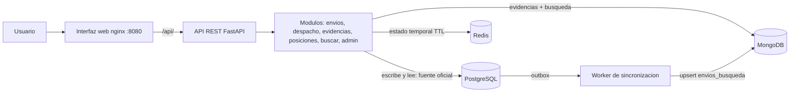

# Diagramas (Mermaid)

Se visualizan directamente en GitHub/GitLab/VS Code. Para obtener PNG: pega cada bloque en https://mermaid.live y exporta.
Guarda los PNG en esta carpeta (`arquitectura.png`, `flujo_crear_envio.png`, `flujo_entrega.png`).

## 1. Arquitectura


## 2. Flujo: crear envio y proyectarlo a la busqueda
```mermaid
sequenceDiagram
  participant C as Cliente (web)
  participant A as API
  participant P as PostgreSQL
  participant W as Worker
  participant M as MongoDB
  C->>A: POST /envios
  A->>P: BEGIN; INSERT envio; INSERT evento; INSERT outbox; COMMIT
  A-->>C: 201 + codigo (comprobante)
  loop cada 2 s
    W->>P: SELECT outbox pendiente FOR UPDATE SKIP LOCKED
    W->>P: lee estado actual del envio
    W->>M: replace_one(upsert) en envios_busqueda
    W->>P: marca outbox procesada
  end
  C->>A: GET /buscar?codigo=...
  A->>M: find
  A-->>C: resultado (puede ir con retraso)
```

## 3. Flujo: entrega con evidencia
```mermaid
sequenceDiagram
  participant R as Repartidor (web)
  participant A as API
  participant M as MongoDB
  participant P as PostgreSQL
  R->>A: POST /envios/{codigo}/entrega (evidencia_id, evento_id)
  A->>P: lee estado (debe ser en_transito)
  A->>M: insert evidencia (_id = codigo)
  alt Mongo caido
    A-->>R: 503 (el estado no cambia)
  else Mongo OK
    A->>P: BEGIN; FOR UPDATE envio; UPDATE estado; INSERT evento; libera cupo; INSERT outbox; COMMIT
    A-->>R: 201 entregado + evidencia
  end
  Note over R,A: Reintento con los mismos IDs = 200 repetido, sin duplicar
```
